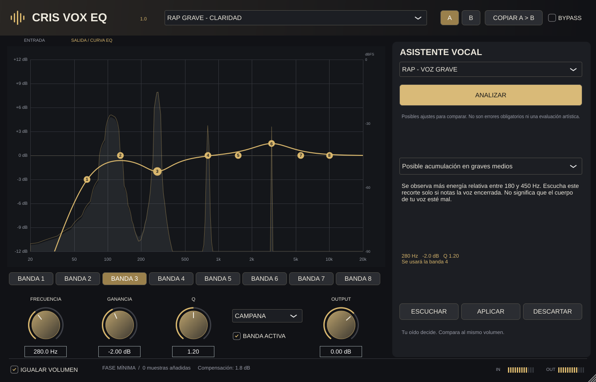

# CRIS VOX EQ 1.0

Ecualizador vocal de ocho bandas, C++17/JUCE 8, con interfaz propia negra y dorada y un asistente de análisis espectral. Proyecto independiente de CRIS VOX TUNER y CRIS VOX ENHANCER.

**Primera versión funcional de desarrollo.** No se presenta como equivalente profesional validado de FabFilter Pro-Q ni como una IA capaz de juzgar una mezcla. El asistente implementa reglas DSP locales y propuestas opcionales. No requiere Internet para ecualizar o analizar.



## Funciones

- Ocho bandas con frecuencia 20 Hz–20 kHz, ganancia ±12 dB y Q 0,15–12.
- Campana, low shelf, high shelf, pasa altos, pasa bajos y notch. Los cortes son de segundo orden, nominalmente 12 dB/octava. Los shelves tienen pendiente fija; Q no los modifica.
- Gráfica interactiva: arrastra un punto para cambiar frecuencia/ganancia; rueda para Q. También puedes seleccionar una banda y usar sus controles.
- Siete presets reales, comparación A/B, bypass y guardado de estado completo.
- Analizador de entrada y salida con FFT en segundo plano. La respuesta dorada representa las bandas EQ; no incluye OUTPUT ni la compensación de volumen.
- ANALIZAR toma unos cuatro segundos de señal y propone hasta tres ajustes suaves.
- ESCUCHAR previsualiza el ajuste sin modificar parámetros; APLICAR lo escribe en una banda libre; DESCARTAR retira esa propuesta de la sesión de análisis.
- Compensación de nivel RMS ajustable, limitada a ±6 dB. Es aproximada y necesita tiempo para estabilizarse; no es normalización LUFS.
- Mono/estéreo, 44,1/48/96 kHz, parámetros automatizables, cero muestras de latencia de buffering añadida.
- Sin fase lineal, sobremuestreo, lookahead, banda dinámica o cadena de compresión/reverb en esta versión.

## Obtener el VST3 Windows desde GitHub

1. Extrae el ZIP y sube **el contenido de la carpeta `CRIS-VOX-EQ`** a un repositorio nuevo. `CMakeLists.txt` debe quedar en su raíz.
2. Incluye `.github/workflows/build.yml`, `.gitignore` y `.gitattributes`; son archivos/carpetas ocultos en algunos exploradores.
3. En GitHub abre **Actions → Build, test and package CRIS VOX EQ → Run workflow**. También se ejecuta al hacer push.
4. Espera a que el trabajo **Windows x64 VST3** termine correctamente.
5. Descarga el artefacto **CRIS-VOX-EQ-Windows-x64** de esa ejecución.
6. Extrae el archivo. Dentro están `VST3/CRIS VOX EQ.vst3` y `Standalone/CRIS VOX EQ.exe`.
7. Copia la carpeta `.vst3` completa a `C:\Program Files\Common Files\VST3` y vuelve a buscar plugins desde el gestor de FL Studio.

Los artefactos son archivos descargables generados por Actions. Este workflow no crea una publicación en Releases. No se ha ejecutado en tu cuenta durante esta entrega. El binario de Linux incluido para comprobación no sirve en Windows.

No debes subir el ZIP entero como un único archivo y esperar que Actions encuentre su contenido. Extrae primero las fuentes. Puedes utilizar GitHub Desktop o, desde la carpeta de fuentes:

```powershell
git init
git add .
git commit -m "Initial CRIS VOX EQ development version"
git branch -M main
```

Agrega luego la URL real de tu repositorio como `origin` y realiza `git push -u origin main`.

## Compilar en Windows

Requisitos: Git, CMake 3.24 o superior y Visual Studio 2022 con **Desktop development with C++**, MSVC v143 y Windows SDK. La primera configuración necesita conexión para descargar JUCE 8.0.13 desde el commit oficial fijado en CMake. No necesita Projucer ni SDK VST2.

```powershell
cmake -S . -B build -G "Visual Studio 17 2022" -A x64 -DCRIS_BUILD_TESTS=ON
cmake --build build --config Release --parallel 2
ctest --test-dir build -C Release --output-on-failure
./scripts/package-windows.ps1 -BuildDirectory build -Destination dist/windows
```

Salida:

```text
build/CrisVoxEQ_artefacts/Release/VST3/CRIS VOX EQ.vst3
```

Copia el **bundle completo**, incluida su carpeta Contents. Usa Release al mezclar. Debug no representa el consumo final. No se incluye un instalador ni firma de código.

## Uso del asistente

1. Inserta el plugin en el canal de una voz aislada, preferiblemente antes de reverb/delay. Empieza con NEUTRO o un preset moderado.
2. Selecciona el contexto vocal y reproduce una parte representativa que dure al menos cuatro segundos.
3. Pulsa ANALIZAR. El worker observa la salida actual del EQ. Si no llega audio continuo, el análisis caduca y pide repetirlo.
4. Lee la propuesta. Habla de posibles desequilibrios, no de errores musicales obligatorios.
5. ESCUCHAR utiliza una banda libre de forma temporal. Deja que IGUALAR VOLUMEN se estabilice antes de comparar. DETENER vuelve a tus ajustes guardados.
6. APLICAR guarda frecuencia, ganancia, Q y tipo campana en esa banda. DESCARTAR deja intacto el audio y oculta la propuesta.
7. Tras cambiar la EQ o aplicar una propuesta, analiza de nuevo. Las propuestas anteriores se invalidan para evitar acumular cambios sobre un diagnóstico antiguo.

Una banda libre es una banda desactivada o una campana con ganancia prácticamente cero. No sobrescribe un recorte o realce activo. Si no queda una libre, debes liberar una manualmente.

El asistente no oye el instrumental mediante sidechain, no compara con grabaciones comerciales, no detecta cantante/tono y no distingue con fiabilidad una resonancia problemática de un armónico propio de la voz. Sus reglas son orientativas. Si no encuentra nada destacable, lo indica en lugar de inventar un ajuste.

## A/B y presets

Los bancos A y B guardan juegos de parámetros de EQ. COPIAR A > B (o B > A) copia el banco actual al otro. Al seleccionar un banco se conserva el que estabas editando. Ambos bancos y el seleccionado se guardan con el proyecto. La letra A/B del EQ no cambia el preset de fábrica elegido en el menú; el nombre muestra el último preset seleccionado, no un indicador de cambios posteriores.

Los presets modifican las bandas y conservan OUTPUT, IGUALAR VOLUMEN y el contexto vocal. Son puntos de partida, no diagnósticos. Ver [PRESETS.md](docs/PRESETS.md).

## CPU y buffer de 2048

El EQ utiliza biquads IIR de fase mínima y memoria preparada antes del callback. El suavizado de coeficientes evita saltos instantáneos de controles. La señal seca y la procesada se interpolan al activar bypass; no hay otro EQ paralelo completo para comparar.

FFT y recomendaciones trabajan en un hilo de baja prioridad. Al cerrar la interfaz, el espectro deja de recibir audio salvo que haya un análisis pendiente. El FIFO es acotado: si se pierde audio durante el análisis, se pide repetir, sin bloquear el callback.

2048 son **muestras por buffer**, no memoria RAM. El proyecto prueba ese tamaño y también tamaños menores. Un buffer grande puede dar más margen al host; no demuestra por sí solo que una sesión vaya a funcionar sin picos. Los resultados medidos y las pruebas pendientes están en [VALIDATION.md](docs/VALIDATION.md).

## Estructura del repositorio

| Ruta | Responsabilidad |
|---|---|
| `CMakeLists.txt` | JUCE fijado, librería DSP, VST3, standalone y tests |
| `Source/PluginProcessor.*` | Audio, automatización, preview, A/B y estado |
| `Source/PluginEditor.*` | Interfaz y flujo del asistente |
| `Source/ui/EQGraph.*` | Respuesta, espectro, nodos y gestos |
| `Source/dsp/Equalizer.*` | Diseño RBJ, biquads, suavizado y compensación |
| `Source/dsp/Spectrum.*` | FIFO sin mutex, FFT y reglas de propuestas |
| `Source/AnalysisWorker.*` | Captura/análisis en segundo plano y resultados |
| `Source/Presets.h` | Presets de fábrica |
| `tests/` | Tests DSP e integración JUCE |
| `.github/workflows/build.yml` | Builds Windows/Linux y artefactos |
| `scripts/package-windows.ps1` | Empaquetado Windows y hashes |
| `docs/` | Capturas, diseño DSP, presets y validación |
| `LICENSE`, `licenses/`, `THIRD_PARTY.md` | Licencias y fuentes de dependencias |

Pruebas DSP sin JUCE:

```powershell
cmake -S . -B build-dsp -DCRIS_BUILD_PLUGIN=OFF -DCRIS_BUILD_TESTS=ON -DCMAKE_BUILD_TYPE=Release
cmake --build build-dsp --config Release
ctest --test-dir build-dsp -C Release --output-on-failure
```

Para compilar en Linux, usa las dependencias listadas en el workflow y ejecuta los tests gráficos bajo X11 o `xvfb-run -a`. La muestra cantada usada por el test se obtiene del árbol de JUCE; no se incluye en el paquete de fuentes.

Fuentes del proyecto bajo **AGPL-3.0-only**. JUCE conserva sus propios avisos. No se incluye licencia comercial de JUCE. Consulta [LIMITATIONS.md](docs/LIMITATIONS.md) antes de considerar esta versión lista para producción.
